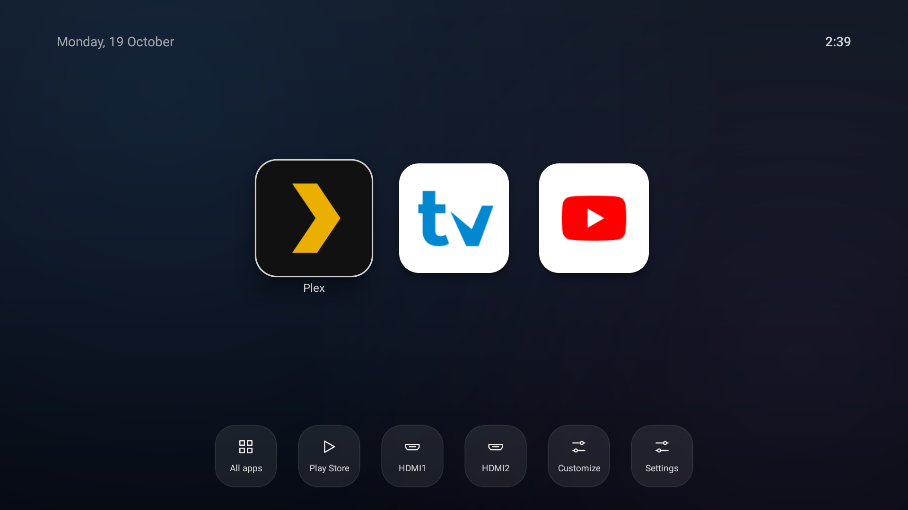
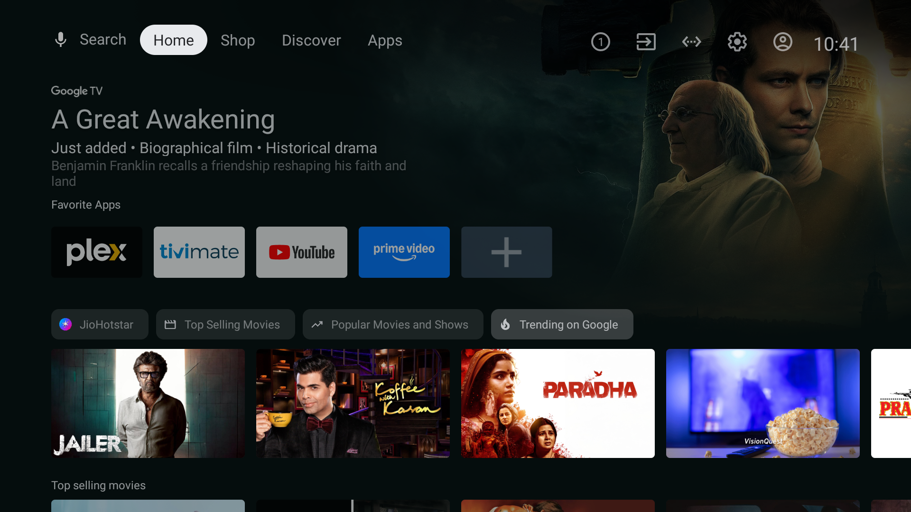
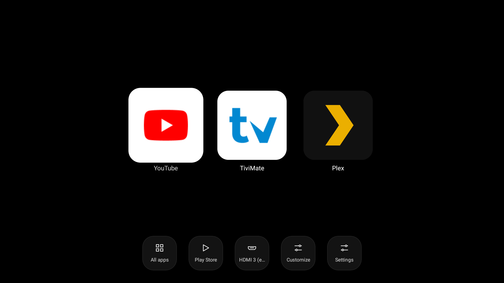
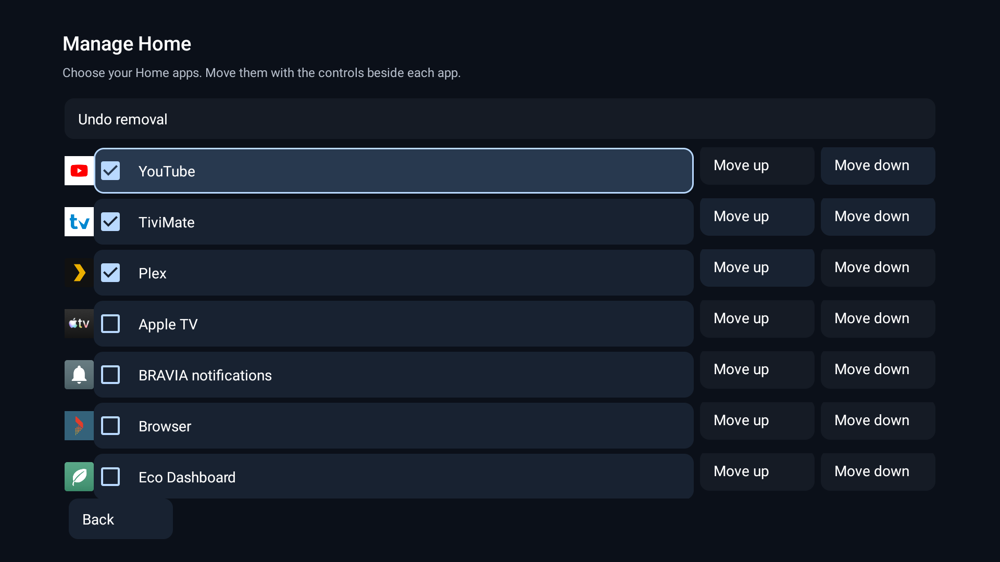
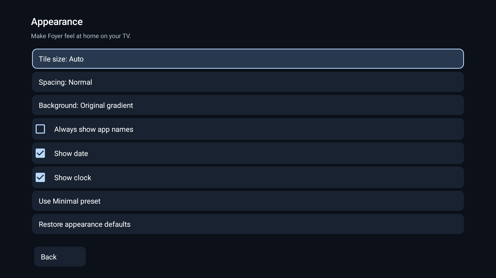
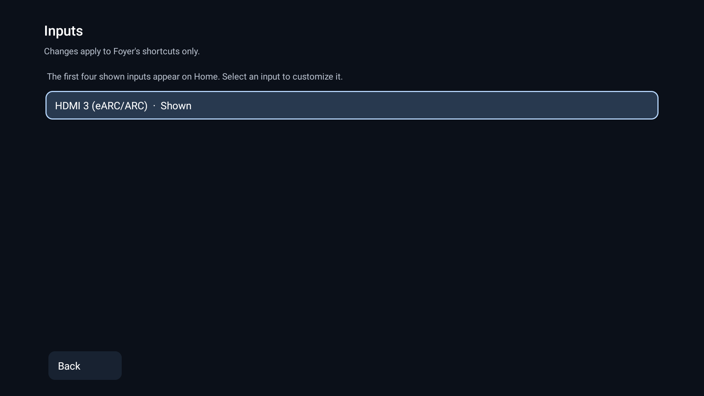

<div align="center">
  
  <h1>Foyer</h1>
  <p><strong>A quieter home for your TV.</strong></p>
  <p>Your apps. Your layout. Straight to watching.</p>
  <p>Set it up with Codex or Claude Code. Use it with your remote.</p>
  <p>Android TV &amp; Google TV · v0.5.0 · Native Java · MIT licensed</p>
  <p>
    <a href="#before-and-after">See the difference</a> ·
    <a href="#get-started">Get started</a> ·
    <a href="docs/INSTALL.md">Install &amp; recovery</a> ·
    <a href="https://github.com/bankerrahul/foyer/issues">Report an issue</a>
  </p>
</div>



Foyer is a customizable launcher for Android TV and Google TV. It puts the apps you choose on a calm home screen, with large tiles, remote-friendly navigation, and quick access to HDMI inputs and settings. Sponsored rows and recommendation feeds stay out of the way.

**No accounts, ads, analytics, or internet permission.** The installed launcher works on its own, without GitHub, a server, or the computer used to build it.

## Before and after

| Original Home | Foyer 0.5.0 |
| :---: | :---: |
| [](docs/assets/home-before.png) | [](docs/assets/home.png) |
| Promotional banners and content rows | Your chosen apps and shortcuts |

Actual captures from the same XGIMI HORIZON Ultra, before customization and after installing Foyer 0.5.0. Click either image for full resolution. The three apps shown are a personal selection; a fresh installation discovers the apps on **your** TV and starts alphabetically.

## Make room for what you watch

| Feature | What you can do |
| --- | --- |
| Choose your Home | Show the apps you want, reorder them with the remote, and hide unwanted tiles without uninstalling anything. |
| Keep every app within reach | Open **All apps** for a scrollable logo grid, including apps hidden from Home. Add them back whenever you like. |
| Make it yours | Adjust tile size, spacing, background, app names, date, and clock. Choose **Minimal** for large tiles on black. |
| Jump to HDMI | Open registered HDMI inputs from Home. Rename, reorder, hide, or change their shortcut icons inside Foyer. |
| Keep your setup | App order, hidden tiles, appearance, and input preferences save locally and survive in-place updates. |
| Return to the previous Home | Preview before switching. Installation saves a device-specific recovery record and includes a restore script. |

<table>
  <tr>
    <td width="50%"><br><strong>Minimal</strong><br>Just the essentials, with the clock and date hidden.</td>
    <td width="50%"><br><strong>Manage Home</strong><br>Choose apps, change their order, and undo a removal.</td>
  </tr>
  <tr>
    <td width="50%"><br><strong>Appearance</strong><br>Make the layout comfortable from your sofa.</td>
    <td width="50%"><br><strong>Inputs</strong><br>Arrange shortcuts for the inputs your TV exposes.</td>
  </tr>
</table>

Settings and Minimal screenshots were captured on a Sony BRAVIA VH1 running Foyer 0.5.0. Apps and available inputs vary by device.

## Get started

**Enable debugging on your TV, then let Codex or Claude Code handle setup.** The assistant prepares the build tools, builds Foyer, connects to your TV, and checks the installation.

1. **Prepare your TV.** Open Settings → About (sometimes under System or Device Preferences), select **Build** seven times, then enable **USB debugging** in Developer options. Enable **Network debugging** or **Wireless debugging** too if your TV offers it. Leave the TV on and note its IP address from network settings.
2. **Open Codex or Claude Code on your computer.** Use a local session with terminal access, on the same home network as the TV. Wi-Fi or Ethernet is fine. You will need to approve the debugging connection on the TV; some models use wireless pairing or require a USB connection.
3. **Paste this prompt.** Fill in your TV details, or let the assistant help you find them.

```text
Set up Foyer as the home screen on my Android TV.
Repository: https://github.com/bankerrahul/foyer
TV model: <brand and model>
TV address: <IP address, or help me find it>

Clone the repository and read AGENTS.md, docs/BUILD.md and
docs/INSTALL.md before acting. Check the required tools on my
computer and help prepare anything missing. Build and test Foyer,
then use its installation scripts for this specific TV.

Discover my installed apps rather than assuming any favourites.
Save the previous Home selection and recovery record. Preview Foyer,
check app launches and remote navigation, then try normal Home
selection and verify that the Home button returns to Foyer.

Ask for my explicit approval before disabling a stock launcher.
If Google TV needs Foyer's optional Accessibility redirect, explain
it and guide me through enabling it myself on the TV.

Do not debloat, uninstall apps, clear app data, or change firmware,
picture, HDMI, animation or power settings. Preserve an existing
Foyer installation's preferences and signing key. If its signing
key is unavailable, stop rather than uninstalling it.

Keep signing keys, recovery records and device details private.
Finish with what changed, what you verified, the saved recovery
file path, and the exact command to restore my previous Home.
```

You handle the TV's debugging and any Accessibility approval prompts; the assistant handles the commands. Setup depends on your TV's debugging support and Home restrictions, so some models need extra guidance. The AI assistant is only used for setup—Foyer itself runs locally without AI or a network connection.

Prefer to install it yourself? Follow the [build guide](docs/BUILD.md) and [installation and recovery guide](docs/INSTALL.md). They include manual commands, signing-key backups, updates, and recovery. Keep the original signing key and first successful activation record for future updates or restoration.

## Use your remote

| Action | Control |
| --- | --- |
| Navigate and open an app | Arrow keys, then **OK** |
| Reorder Home | Hold **OK** on an app → **Move** → arrows → **OK** to save, **Back** to cancel |
| Hide a Home tile | Hold **OK** → **Remove from Home** |
| Restore a hidden app | **All apps** → hold **OK** on it → **Add to Home** |
| Undo the last removal | **Customize** → **Manage Home** → **Undo removal** |
| Reset focus on Home | Press **Back** to focus the first visible app |
| Change the layout or inputs | **Customize** in the utility row |
| Open Android's device settings | **Settings** in the utility row |

Back closes All apps before returning to normal Home navigation. Leaving during a move cancels the unsaved edit. Newly installed apps join the saved order; removed apps disappear. Resetting app order keeps hidden choices intact.

For an optional starting order, use `apps.txt` or `--apps pkg.one,pkg.two` during installation. Use `--apps auto` to reset ordering to alphabetical discovery. Omit `--apps` when updating to preserve a saved order. [More about discovery and ordering](docs/INSTALL.md#app-discovery-and-order).

## Return to your previous Home

Want your old home screen back? Open the same Codex or Claude Code conversation on the computer you used for setup, keep the TV on with debugging enabled, and paste:

```text
Switch my TV back to the home screen it used before Foyer.
Use the saved setup record and Foyer's recovery guide.
Turn off Foyer's Home button redirect if enabled, restore the
previous Home, and check that the remote's Home button opens it.
Leave my apps, their data, and Foyer installed.
If the saved record is missing, ask me before making changes.
```

Keep the Foyer setup folder on your computer—it contains the saved recovery information. The assistant handles the restore commands and guides you through any TV prompts.

Prefer to do it yourself? See the [manual recovery guide](docs/INSTALL.md#recovery) and [Google TV Home button details](docs/INSTALL.md#optional-google-tv-redirect).

## Compatibility

Foyer targets Android TV and Google TV on landscape 16:9 displays. The manifest declares **Android 6 / API 23 minimum** and **API 34 target**; the minimum is not a claim of testing every Android version.

Foyer 0.5.0 has been installed and checked on:

| Device | Android | Home method checked |
| --- | --- | --- |
| XGIMI HORIZON Ultra / XK03H | 11 | Normal Home selection; recovery to the previous custom launcher |
| Sony BRAVIA VH1 | 12 | Home selection with an explicitly approved stock launcher disable; recovery verified |
| Sony BRAVIA VU3 | 14 | Optional Accessibility Home redirect; stock Google TV packages retained |

Home selection, wake/restart behavior, HDMI registration, and vendor settings depend on firmware. Direct HDMI shortcuts require standard inputs exposed by the TV. If none are registered, Foyer can offer a native input selector when one is accessible. It cannot create missing hardware registrations. Samsung Tizen, LG webOS, and Fire TV compatibility are not claimed.

Foyer changes the home screen. It does not debloat the TV, modify firmware or picture settings, or remove advertising inside other apps. No measured performance improvement is claimed. See the [validation record](docs/VALIDATION.md) for automated checks, physical-device results, and remaining limits.

## Build on Foyer

Foyer is a small native Java app with no third-party runtime libraries. The package is `app.foyer.launcher`. The build uses Python's standard library and Android SDK tools.

| Start here | Purpose |
| --- | --- |
| [MainActivity.java](src/app/foyer/launcher/MainActivity.java) | Home layout, All apps, remote navigation, and tile actions |
| [SettingsActivity.java](src/app/foyer/launcher/SettingsActivity.java) | Manage Home, appearance, and input customization |
| [LauncherData.java](src/app/foyer/launcher/LauncherData.java) | App and input discovery and saved preferences |
| [scripts/](scripts/) | Build, signing, installation, and recovery |
| [tests/](tests/) | Java models, generated APK checks, and simulated ADB recovery cases |

Run `sh test.sh` after changes and `sh build.sh` for Android code, resources, or manifest changes. The current validation record reports **29 passing automated tests**, alongside physical checks on the devices above. Simulated-device tests do not establish compatibility with every TV.

Have a bug or an idea? [Open an issue](https://github.com/bankerrahul/foyer/issues) with the Foyer version, TV model, Android version, and steps to reproduce. Remove device addresses and personal information from logs or screenshots. Keep signing keys, recovery records, and build output private. See [build and signing](docs/BUILD.md) and [installation and recovery](docs/INSTALL.md) before changing those paths.

## License

[MIT](LICENSE). The original license and copyright notice are preserved in this repository and bundled in the APK at `assets/LICENSE`. Keep them when redistributing the code or a substantial portion of it. Third-party app names, logos, and promotional artwork in screenshots belong to their respective owners; their appearance does not imply endorsement.
